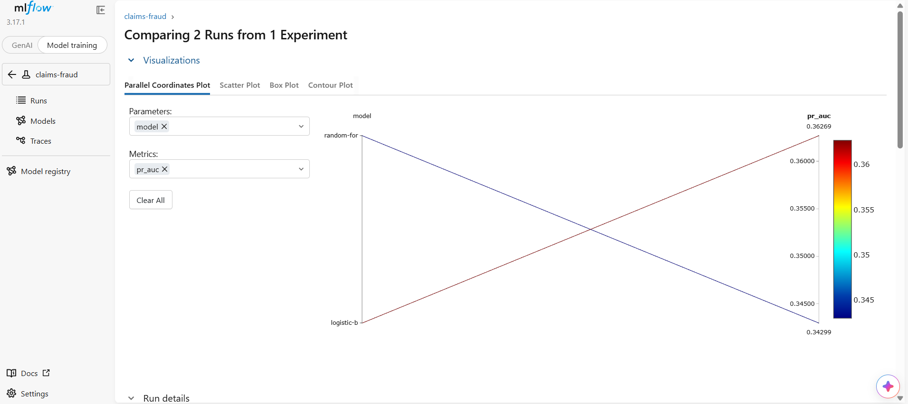

# Claims Intelligence Platform

A motor insurance claims system that scores fraud risk with an explainable model and, in the next stage, answers questions over claim documents using retrieval-augmented generation. Built to show the full path from data to a tested, deployable service.

**Status:** fraud scoring layer complete (training, MLflow tracking, SHAP explanations, tests, CI). API, RAG layer, monitoring and deployment are in progress.

## The problem

Claims handlers cannot review every claim. Missing a fraudulent claim is expensive, but investigating genuine claims wastes time and annoys customers. The model has to support a decision about where to spend investigation effort, so it is judged on cost, not accuracy.

## Data card

The data is synthetic: 5,000 UK motor claims with a fraud rate of about 5 per cent, generated in `src/fraud/data.py`. Fraud depends on claim size, claims history, reporting delay, policy age, a flagged garage, and one interaction (new policy, large claim, slow reporting) that a linear model cannot capture. It is not real customer data and results will not transfer directly to a live portfolio.

## Approach

1. Stratified train and validation split, because fraud is rare.
2. Two models compared: a logistic regression baseline and a random forest, both with class weighting.
3. A decision threshold chosen to minimise expected cost, using stated assumptions of £4,000 for each missed fraud and £150 for each unnecessary investigation.
4. The champion is the model with the lowest expected cost. All runs are tracked in MLflow.
5. SHAP values explain each score, so a handler sees which factors raised or lowered the risk.

## Results (validation set)

| Model | PR-AUC | ROC-AUC | Precision | Recall | Expected cost |
|---|---|---|---|---|---|
| logistic-baseline | 0.36 | 0.82 | 0.15 | 0.75 | £111,650 |
| random-forest | 0.35 | 0.82 | 0.14 | 0.78 | £109,800 |

Base fraud rate in the validation set is 5.4%. Champion: **random-forest**.

Precision is low by design. At these costs it is cheaper to investigate several genuine claims than to miss one fraud, so the threshold favours recall. Changing the cost assumptions changes the threshold, and that trade-off is the main thing to discuss with the business.



## Run it

```bash
python -m venv .venv && source .venv/bin/activate
pip install -r requirements.txt
python -m src.fraud.data      # generate data
python -m src.fraud.train     # train, compare, log to MLflow
python -m pytest -q           # run tests
mlflow ui --backend-store-uri sqlite:///mlflow.db
```

## Limitations

- Synthetic data, so the headline numbers show the method, not real-world performance.
- Cost assumptions are illustrative.
- No fairness analysis yet. A production system would need to check outcomes across protected characteristics.

## Roadmap

- [x] Fraud model, cost-based threshold, MLflow, SHAP, tests, CI
- [ ] FastAPI service with validation
- [ ] RAG layer with citations and an evaluation set
- [ ] Docker and cloud deployment
- [ ] Drift monitoring
- [ ] Streamlit dashboard and demo video

## Author

Swathi Mulkundkar
